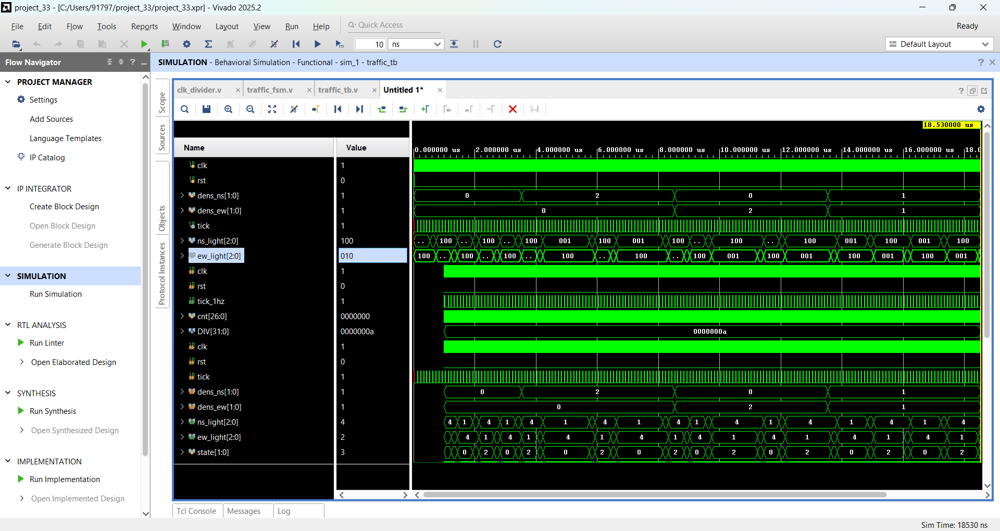
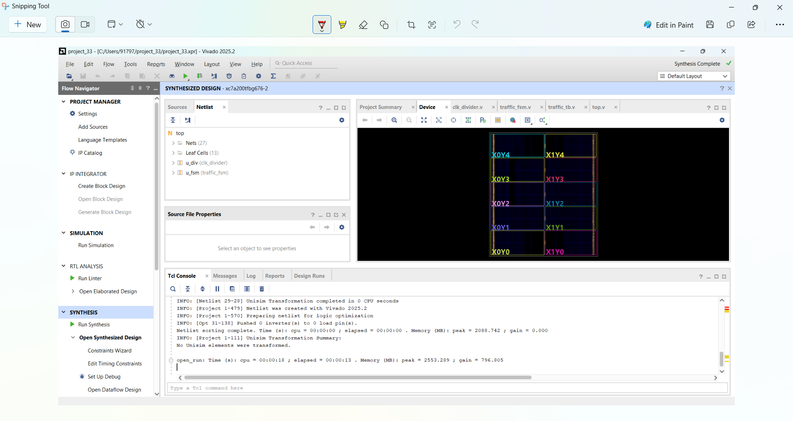
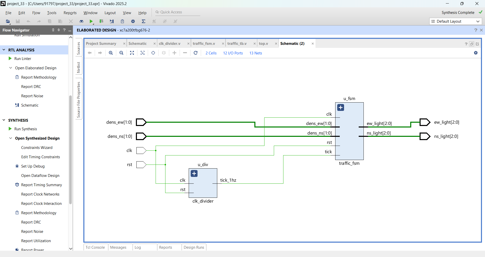
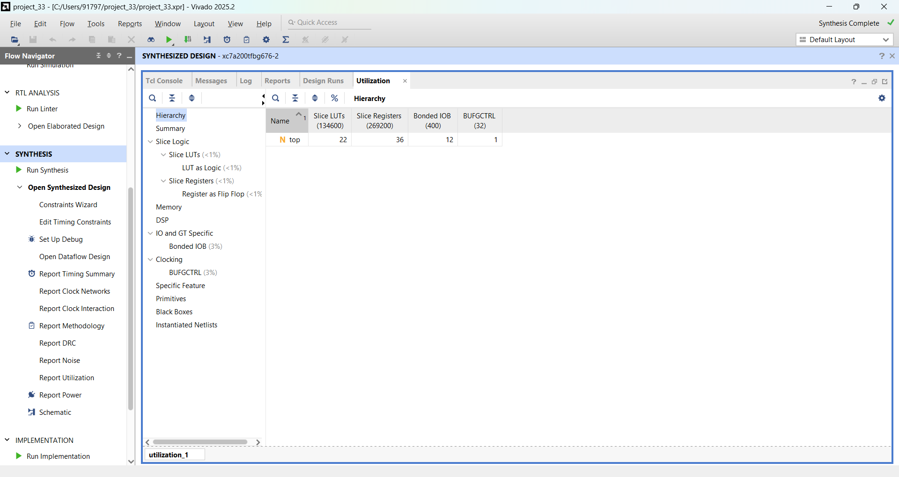

# Smart Traffic Light Controller

FSM-based traffic light controller for a 4-way junction, written in Verilog and simulated and synthesized in Xilinx Vivado.
Green time adapts to the traffic density on each road.

## How it works

The junction has two phases: North-South (NS) and East-West (EW). The FSM has 4 states:

NS_GREEN -> NS_YELLOW -> EW_GREEN -> EW_YELLOW -> (repeat)

Green time depends on a 2-bit density input of the road that is about to get green:

| Density input | Meaning | Green time |
|---|---|---|
| 0 | Low | 5 s |
| 1 | Medium | 10 s |
| 2 or 3 | High | 15 s |

Yellow is always 2 s. Density is read at the start of each green phase. Light outputs are 3-bit {Red, Yellow, Green} for each direction.

## Files

| File | Description |
|---|---|
| clk_divider.v | Divides 100 MHz clock to a 1 Hz tick |
| traffic_fsm.v | 4-state FSM with adaptive green timer |
| top.v | Connects clock divider and FSM |
| traffic_tb.v | Testbench (uses a small divider so the simulation runs fast, 1 tick = 100 ns) |

## Simulation results

The testbench changes the traffic density of both roads (low, NS high, EW high, both medium) and also checks that both directions are never green at the same time.

- Green lasted 5 / 10 / 15 ticks for low / medium / high density
- Yellow lasted 2 ticks every time
- No "both directions green" error during the run

## Synthesis

Synthesis completed in Vivado with top as the top module.

### Schematic

### Utilization

## How to run

1. Create a Vivado RTL project and add clk_divider.v, traffic_fsm.v and top.v as design sources.
2. Add traffic_tb.v as a simulation source and set it as top.
3. Run Behavioral Simulation, then run all in the Tcl console.
4. For synthesis, set top as the top module and click Run Synthesis.

## Status

Simulation and synthesis are complete. Pin constraints for a physical board are not added yet.
